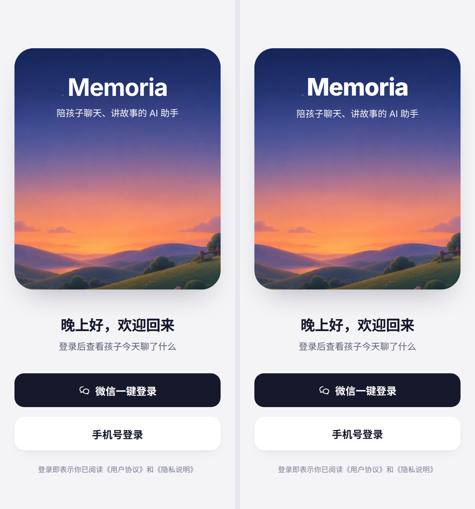
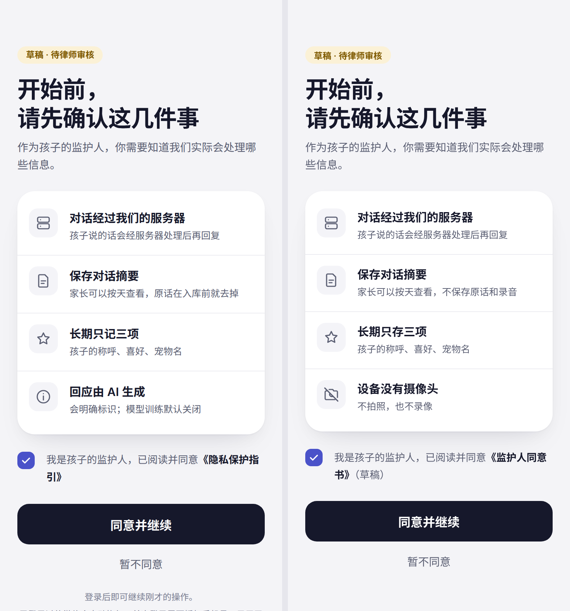
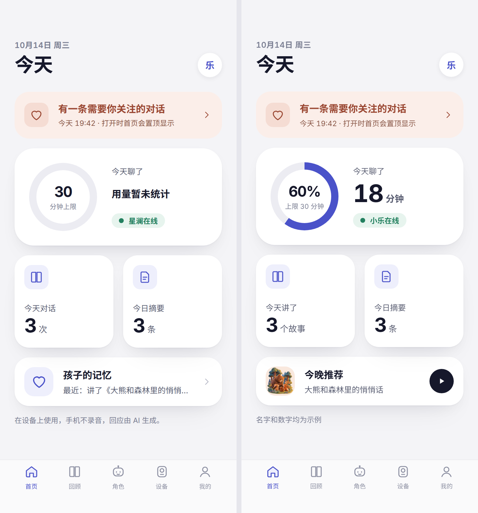
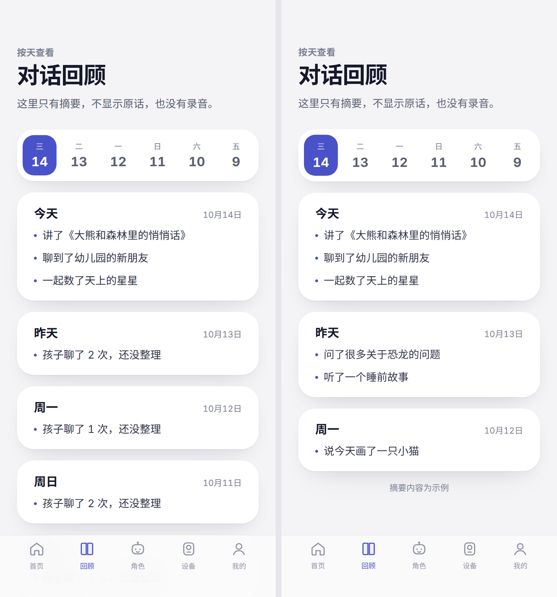
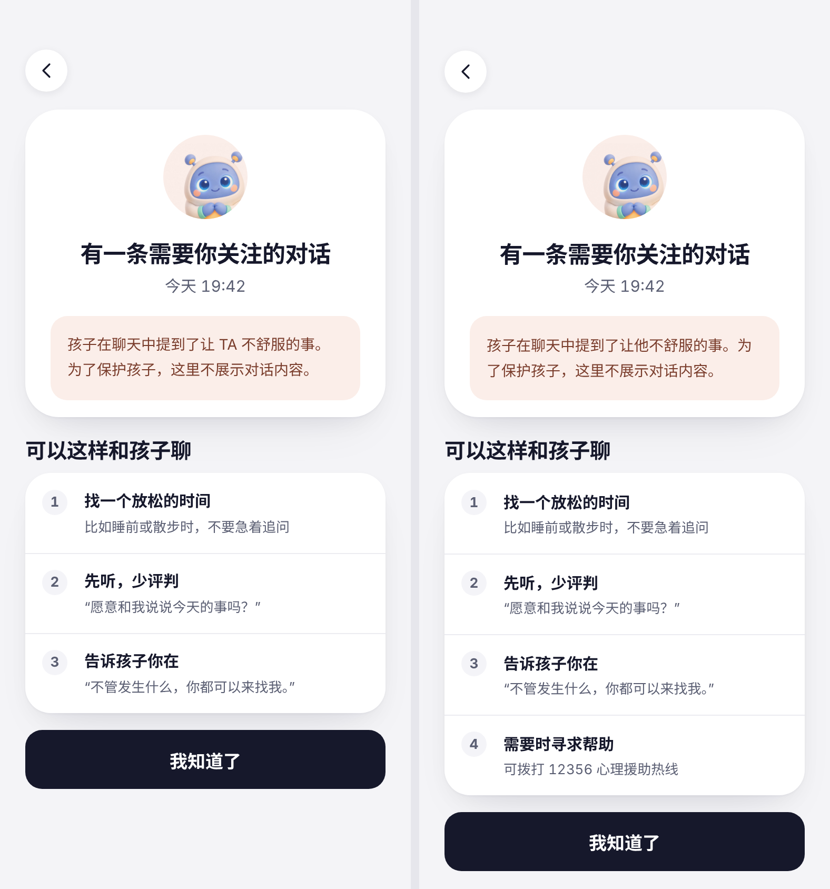
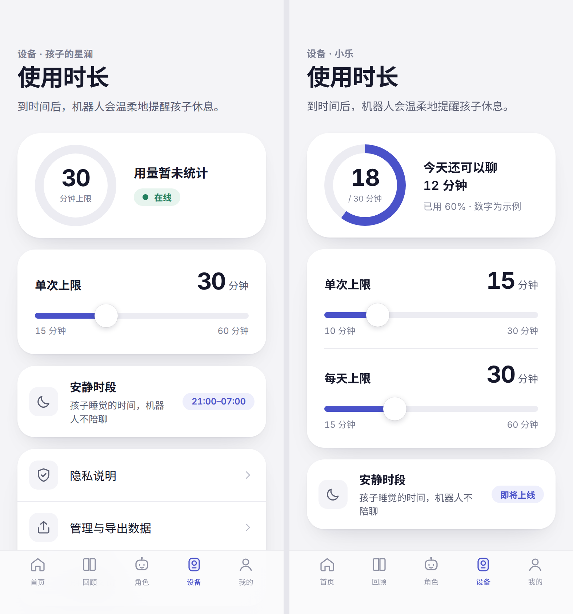
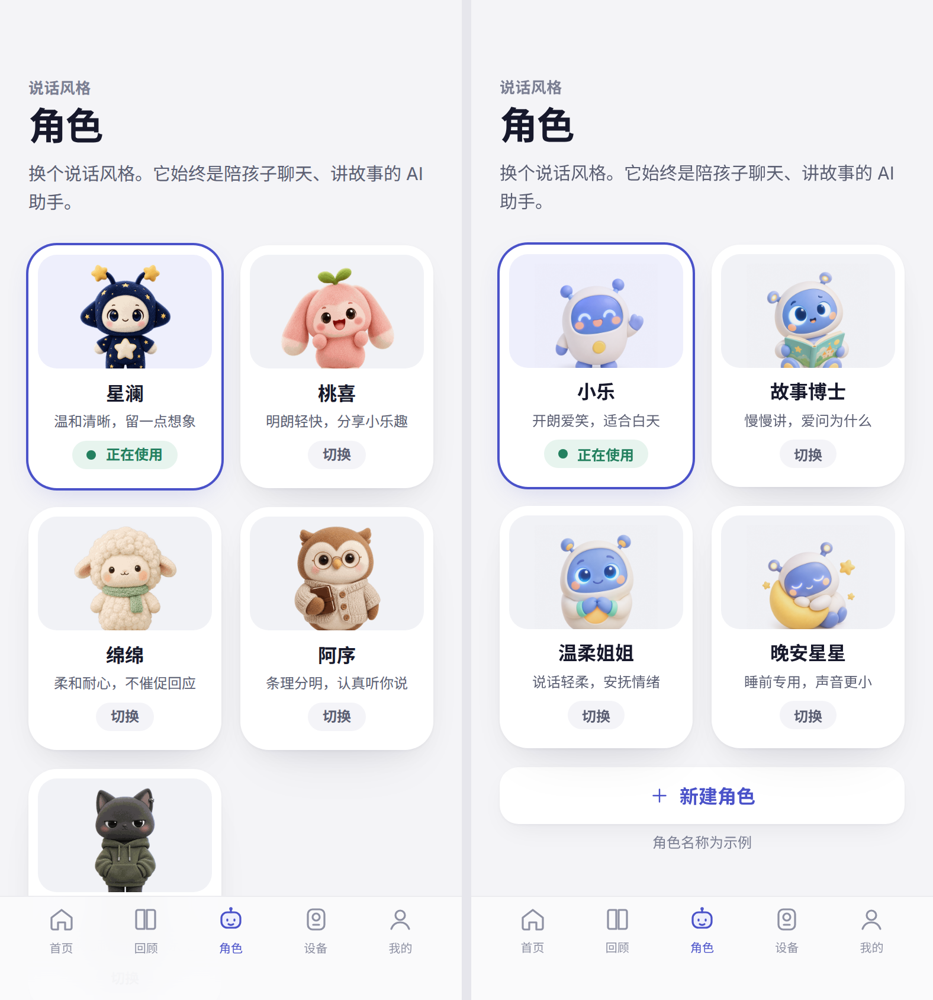
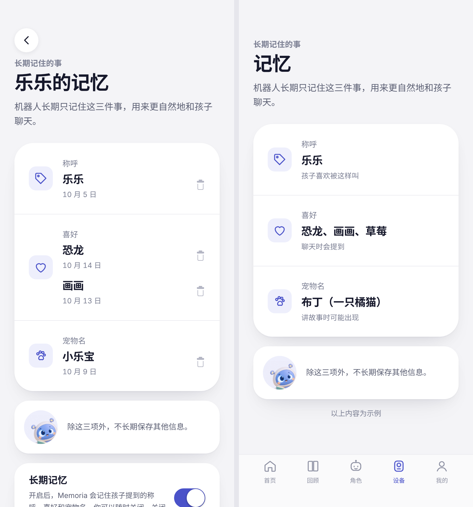
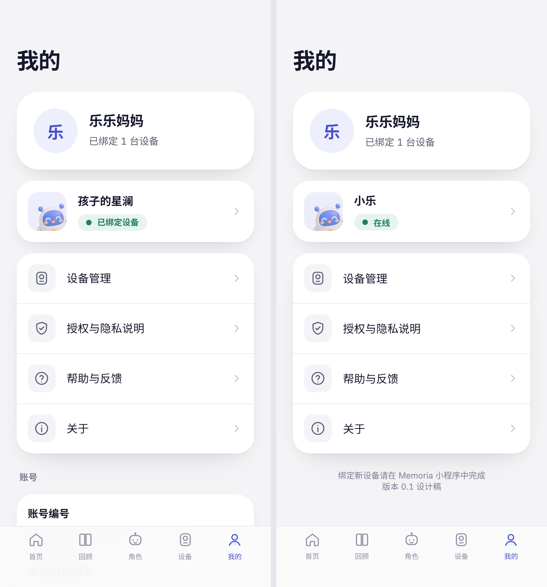

# Mini program v4 test report

This report records how the v4 restyle of the Memoria WeChat mini program was tested on branch `cursor/miniprogram-design-v4-14a0`. It covers every page under `apps/miniprogram/pages`. It lists the commands, the measured results, side-by-side images against the design PNGs in this folder, and each place where the mini program still differs from the design.

Every number comes from runs on 2026-10-14 on a Linux cloud VM with 4 cores, Node v22.14.0 and headless Chrome driven by puppeteer-core. Nothing ran in WeChat DevTools, through miniprogram-automator or on a phone, because none of them is available on the VM. The harness approximates the WeChat renderer. Read the images as close evidence of layout and copy, not as proof of on-device pixels.

## Results

| Check | Result |
|---|---|
| Unit, function, perf and layout tests (`npm test`) | 524 of 524 pass, 0 skipped |
| Forbidden UI copy (`npm run check:forbidden-copy`) | Pass on 63 files |
| `12356` in shipped `.js`, `.wxml`, `.json` and `.wxss` files | Absent |
| `node --check` on every tracked JS file in the app | 0 failures in 134 files |
| Page screenshots at five views (`scripts/screenshot-pages.js`) | 145 shots, 0 layout issues |
| Parity side-by-sides (`scripts/v4-parity/render-and-compare.js`) | 9 mapped screens, diffRatio 0.057 to 0.356, down from 0.245 to 0.647 |
| Main package before minification (`scripts/package-size.js`) | 1874.3 KiB of the 2048 KiB limit |

## How the harness works

The harness lives in `apps/miniprogram/scripts/mp-harness/`. It runs the real page code, so each screenshot shows what the page produced from fixture API responses, not exported design HTML.

- `runtime.js` loads a page module with stubbed `wx` APIs, runs its `onLoad` and `onShow`, and records every `setData` call with its JSON size.
- `render.js` turns the page WXML, the resulting data, the page WXSS and `app.wxss` into HTML, and adds `custom-tab-bar` on tab pages.
- `shoot.js` lays the HTML out in Chrome, measures it and can save a PNG.
- `fixtures.js` pins the clock to 2026-10-14 19:42 in Asia/Shanghai and returns the API shapes the pages call in production.
- `pages.js` lists 29 page states and the five views below.

| View | Width | Height | Status bar | Home indicator | Font scale |
|---|---:|---:|---:|---:|---:|
| 390 | 390 | 844 | 47 | 34 | 1 |
| 320 | 320 | 568 | 20 | 0 | 1 |
| 375 | 375 | 667 | 20 | 0 | 1 |
| 430 | 430 | 932 | 59 | 34 | 1 |
| 390-large-font | 390 | 844 | 47 | 34 | 1.3 |

Sizes are CSS px. The 390 view captures the full page height and the others capture one screen. The large-font view multiplies every font size and type token by 1.3 to stand in for the system large-text setting, which the harness cannot drive.

All v4 lengths are px. `scripts/codemods/rpx-to-px.js` halved every rpx length in commit `1869d4f1`, and `v4-tokens.test.js` rejects rpx in templates and styles. `render.js` still converts any rpx at 750 per screen width.

## Reproduce

Run from `apps/miniprogram`. The tests and scripts set `TZ=Asia/Shanghai` themselves.

```bash
cd apps/miniprogram
npm test
npm run check:forbidden-copy
node scripts/screenshot-pages.js
node scripts/v4-parity/render-and-compare.js
node scripts/v4-parity/design-floor.js
node scripts/v4-parity/diff-bands.js
node scripts/perf-report.js
node scripts/package-size.js
```

The Chrome steps need `puppeteer-core` from `package.json` and Chrome at `CHROME_PATH`, `/usr/local/bin/google-chrome` or `/usr/bin/google-chrome`. Without them `v4-layout.test.js` skips and reports why.

Do not run `npm --prefix apps/miniprogram exec -- node scripts/v4-parity/render-and-compare.js` from the repo root. `npm exec` keeps the caller's working directory, so the script path resolves against the repo root and Node exits with `MODULE_NOT_FOUND`.

## Visual parity

`render-and-compare.js` renders each mapped page state at the design frame of 390 by 844 CSS px at 2x, with a 47 px status bar and a 34 px home indicator. It writes three files per screen:

- `mp-screenshots/actual/<slug>.png` is the live page.
- `mp-screenshots/side-by-side/<slug>.png` puts the live page on the left and the design PNG on the right, each pane 780 by 1688.
- `mp-screenshots/metrics/<slug>.json` holds the diff numbers and the layout checks.

`diffRatio` is the share of pixels whose squared RGBA distance from the design exceeds 25. A card that sits 4 px lower counts all of its pixels as different. So the ratio mostly measures where content lands and how much of it there is, and real data changes both. Treat it as a regression signal and as a pointer to where a screen differs, not as a parity score.

### The floor no live page can beat

`design-floor.js` renders the design source, `docs/design/app-v4/app.html`, in this VM's Chrome at the same frame and diffs it against the PNG exported from that same HTML. The layout is identical, so the floor is font and rasteriser drift alone. The VM has Noto Sans CJK SC and no PingFang SC, which is most of that drift. A live page cannot score below its screen's floor on this machine.

| Screen | Live page and state | Before | Now | Floor |
|---|---|---:|---:|---:|
| 01-login | `pages/home`, guest | 0.6475 | 0.0575 | 0.0572 |
| 02-consent | `pages/auth`, guest | 0.3906 | 0.0945 | 0.0883 |
| 03-home | `pages/home`, signed in | 0.3162 | 0.0703 | 0.0490 |
| 04-summary | `pages/memory`, today summarized | 0.3394 | 0.1901 | 0.0430 |
| 05-attention | `pages/attention`, one open alert | 0.4991 | 0.1938 | 0.0536 |
| 06-usage | `pages/device`, child usage settings | 0.2527 | 0.1825 | 0.0527 |
| 08-roles | `pages/companion` | 0.3539 | 0.1810 | 0.0727 |
| 09-memory | `pages/child-memory`, long-term memory | 0.3706 | 0.3560 | 0.0279 |
| 10-profile | `pages/profile`, signed in | 0.2450 | 0.0715 | 0.0116 |

Before is the committed `compare-summary.json` at `b63fa853`. That run shot 05-attention on the review tab, where the alert rendered inline. It now shoots the attention detail page the design shows. Reruns on an unchanged tree give identical ratios. The last two full runs differ only on 02-consent, the one screen whose copy changed between them.

### Where the remaining difference sits

`diff-bands.js` splits each pair into eight bands of 211 device px, about 105 CSS px each, and prints the diffRatio of each band. The columns below are the band's top edge in CSS px.

| Screen | 0 | 105 | 211 | 316 | 422 | 527 | 633 | 738 |
|---|---:|---:|---:|---:|---:|---:|---:|---:|
| 01-login | 0.001 | 0.063 | 0.001 | 0.095 | 0.191 | 0.044 | 0.034 | 0.031 |
| 02-consent | 0.019 | 0.039 | 0.043 | 0.139 | 0.098 | 0.232 | 0.111 | 0.075 |
| 03-home | 0.016 | 0.065 | 0.072 | 0.122 | 0.032 | 0.116 | 0.122 | 0.017 |
| 04-summary | 0.017 | 0.059 | 0.040 | 0.063 | 0.055 | 0.349 | 0.769 | 0.168 |
| 05-attention | 0.004 | 0.008 | 0.030 | 0.082 | 0.052 | 0.077 | 0.565 | 0.732 |
| 06-usage | 0.024 | 0.066 | 0.161 | 0.045 | 0.260 | 0.444 | 0.287 | 0.172 |
| 08-roles | 0.013 | 0.068 | 0.260 | 0.110 | 0.268 | 0.126 | 0.543 | 0.061 |
| 09-memory | 0.064 | 0.193 | 0.331 | 0.107 | 0.131 | 0.283 | 0.761 | 0.979 |
| 10-profile | 0.000 | 0.039 | 0.030 | 0.032 | 0.015 | 0.015 | 0.262 | 0.179 |

01-login scores its floor, so its bands are drift in the hero image and the type. On every other screen the bands above 0.2 line up with one of the data, copy or structure differences listed under its image. Each pair was also read by eye.

07-content has no live page. It is a story catalogue with play buttons, and the app has no story list or story data, so a mapped page would need invented stories.

### 01-login



The guest home is the full-bleed login screen with no tab bar. The greeting follows the clock, so the fixture's 19:42 gives the design's 「晚上好，欢迎回来」. 「微信一键登录」 restores a returning WeChat identity and otherwise opens the auth page. 「手机号登录」 opens the auth page directly, where WeChat's own phone authorization runs. Neither button adds an SMS form. The tab bar returns once the guest signs in.

### 02-consent



The consent screen leads the auth page, with the facts card, the guardian tick, 「同意并继续」 and 「暂不同意」 above the fold. The name and avatar step comes after phone authorization, and only on a first registration. Three fact strings differ from the design on purpose.

- Fact 2 ends with 「原话在入库前就去掉」, not 「不保存原话和录音」. A family that opts in on the privacy page has raw audio kept until it revokes, so 「不保存录音」 would be false for that family.
- Fact 3 reads 「长期只记三项」, the wording of the memory page's 「机器人长期只记住这三件事」.
- Fact 4 is 「回应由 AI 生成」 in place of 「设备没有摄像头」. `auth-layout.test.js` pins the four facts and rejects a camera claim.

The checkbox names 《隐私保护指引》, the document `wx.openPrivacyContract` opens, because the app has no separate guardian consent document. Notes on login and recording follow 「暂不同意」, below the design's last line. The highest band, from 527 CSS px, is the fourth fact and the checkbox line.

### 03-home



The cards, radii, shadows, gaps, type scale and icon tiles follow the design. The three bands above 0.1 are the ring, the stat units and the memory card. The ring shows the 30 minute limit on an empty track with 「用量暂未统计」, because no API field reports minutes used today. `home-v4-dashboard.test.js` covers both the empty ring and a ring filled from a real tally. 「今天对话 3 次」 replaces 「今天讲了 3 个故事」, and the 孩子的记忆 card replaces 今晚推荐, because no story field exists. The AI disclosure line replaces 「名字和数字均为示例」, and the pill names the fixture's role, 星澜.

### 04-summary



The 「按天查看」 header, the day strip and today's card match the design. The high bands from 527 CSS px are the cards below today. The fixture has summaries for today only, so 昨天 and 周一 show the honest 「孩子聊了 N 次，还没整理」 where the design shows sample bullets, and a fourth card, 周日, fits on screen. The design's 「摘要内容为示例」 caption has no counterpart. 记住的事 moved from a switcher above the strip to a row under the day cards, below the fold.

### 05-attention



The attention detail page is new. Home's attention card and the review banner open it. It has the design's back button, mascot, peach box, numbered tips and 「我知道了」, which returns to where the parent came from. No band above 633 CSS px exceeds 0.082. The two bottom bands are the design's fourth tip, the 12356 hotline, which the copy rules remove, so 「我知道了」 sits one row higher. The peach box says TA where the design says 他, the neutral pronoun the guardian alerts already use.

### 06-usage



The slider card, the quiet-hours card, the online pill and the row chrome follow the design. The band from 211 CSS px is the ring, which shows the limit with 「用量暂未统计」 for the same reason as home. From 422 CSS px down, the difference is the design's second slider, 每天上限. The device enforces only the signed per-session `MAX_SESSION_SECONDS` limit, in `services/agent/src/voice_core/minor_session_limits.py`, so the page has one 单次上限 slider from 15 to 60 minutes. The design's 单次上限 runs from 10 to 30. 安静时段 shows the real window from 21:00 to 07:00 in place of 即将上线. That chip is wider, so the card copy wraps one character earlier. With one slider, the 隐私说明 and 管理与导出数据 rows rise into view. The eyebrow names the device with `devicePlaceName`, so it reads 「设备 · 孩子的星澜」.

### 08-roles



The grid cards, the selected border, the 正在使用 pill and the 48 px 新建角色 button match the design. Names, art and taglines come from the live catalogue, so five roles (星澜, 桃喜, 绵绵, 阿序 and 玄墨) replace the design's four samples. The bands from 211 and 422 CSS px are the different mascots. The fifth card takes the place of the 新建角色 button, which moves below the fold, and that is the band from 633 CSS px. There is no 「角色名称为示例」 caption.

### 09-memory



The archive leads the page with the design's labels 称呼, 喜好 and 宠物名, their icons, and the mascot card 「除这三项外，不长期保存其他信息。」. The page is secondary, so it opens with a back button and has no tab bar. That button pushes everything 31 CSS px down, which explains most of the top half. `node scripts/v4-parity/diff-bands.js --shift 62 09-memory` moves the live image up by that offset, and the bands from 105 and 211 CSS px drop from 0.193 and 0.331 to 0.074 and 0.029.

Three content differences remain. The title names the child, 乐乐的记忆, where the design says 记忆. Each fact has its own line with its date and a delete button, so 喜好 lists 恐龙 and 画画 separately where the design joins 「恐龙、画画、草莓」, and the dates take the place of the design's captions such as 「孩子喜欢被这样叫」. Below the mascot card come the 长期记忆 consent card and the summaries. The design ends there with 「以上内容为示例」 and its tab bar, which accounts for the bands at 0.761 and 0.979.

### 10-profile



The page has the design's title, the account card with 「已绑定 1 台设备」, the device card with the mascot, and the four rows 设备管理, 授权与隐私说明, 帮助与反馈 and 关于. 帮助与反馈 is WeChat's native feedback button. 关于 shows 「陪孩子聊天、讲故事的 AI 助手。」 and the version. 授权与隐私说明 opens the raw-audio consent page when that capability is open, and WeChat's privacy guideline otherwise. The role and custom persona rows moved to the 角色 tab.

The device card reads 孩子的星澜 with 已绑定设备, not 小乐 with 在线, because the profile page does not fetch presence. The two bottom bands are the 账号 group with 账号编号, 退出当前设备, 退出所有设备 and 永久注销, which the design does not show. The design's 「绑定新设备请在 Memoria 小程序中完成」 is gone, because this is the mini program and binding lives on the 设备 tab. The version line reads 「版本 x.y.z」 in a release build and 开发版 or 体验版 before release, never 「版本 0.1 设计稿」.

## Differences from the design

### Platform differences

These come from WeChat or the test machine, and no page change removes them.

- With `navigationStyle: "custom"`, WeChat still draws its menu capsule at the top right. The home avatar moves down to clear the capsule's real rect from `wx.getMenuButtonBoundingClientRect`, which sits lower on Android than on iOS.
- Custom navigation removes the native back button, so secondary pages draw their own round back button under the status bar. On 09-memory, a tab page in the design, that button shifts the page 31 px down.
- Lengths are px, not the recipe's rpx at twice the design px. Those rpx values are exact only on a 375 pt screen and render 4% larger at the 390 design frame. In px the design frame renders 1:1, and 320 and 430 screens keep the design's sizes.
- `<button open-type="feedback">` is the only way to open WeChat's feedback page, and WeChat buttons ship their own width, padding, radius, fill and bold text. The profile stylesheet resets them so the row matches the other three.
- The VM renders CJK text in Noto Sans CJK SC. A phone uses PingFang SC or the Android system font, so line widths differ slightly on device.

### Differences the data and copy rules require

- No used minutes, story counts, recommendation card or battery appear, because no API field backs them.
- No 12356 appears, and none of 危机, 伙伴, 好朋友, 家人, 推送 or 通知 appears in the UI.
- Subscription and push UI stays behind `subscriptionPushEnabled`, which defaults to false.
- Fixture names, roles, dates and counts replace the design's samples and its 「数字为示例」 captions.
- Usage has one per-session slider, because the device has no daily cap.
- Three consent facts and the consent link differ, as listed under 02-consent.
- The attention copy uses TA.
- 07-content has no page.

### Differences that follow the app's structure

- Long-term memory is a secondary page with a back button and no tab bar, and it keeps per-fact dates and delete buttons.
- 记住的事 opens from a row under the day cards, not a switcher.
- The quiet-hours chip shows the real window, and the privacy rows follow it on the usage screen.
- The profile keeps the account and deletion actions below the menu, and drops the design's binding note.

## Layout checks across widths

`v4-layout.test.js` renders all 29 page states at all five views, 145 layouts in one test. A layout fails when any of these holds:

- The document is wider than the view.
- An element extends past the left or right edge without a clipping ancestor.
- A tappable element overlaps the capsule on a custom-navigation page.
- Content on a tab page ends closer to the page bottom than the tab bar's height.

All 145 pass. `screenshot-pages.js` runs the same checks while it writes the PNGs and records them in `mp-screenshots/pages/results.json`.

## Page screenshots

`mp-screenshots/pages/` holds one PNG per page state and view, named `<slug>-<view>.png`. The 390 full-page and 320 shots are committed, 58 files and 3.9 MB. The 375, 430 and large-font shots add 5.7 MB, so `pages/.gitignore` excludes them and `node scripts/screenshot-pages.js` regenerates them.

The 29 page states are these:

- Home: `home`, `home-guest`.
- Review tab: `memory`, `memory-attention`, `memory-empty`, `memory-empty-memories`.
- Roles tab: `companion`.
- Device tab: `device`.
- Profile tab: `profile`.
- Guardian: `guardian`.
- Bind: `bind`, `bind-mode`, `bind-form`, `bind-review`.
- Custom persona: `persona-custom`.
- Auth: `auth`, `auth-profile`.
- Attention: `attention`, `attention-empty`.
- Privacy: `privacy`, `privacy-granted`.
- Digital self: `digital-self`, `digital-self-empty`.
- Child memory: `child-memory`, `child-memory-archive`.
- Device onboarding: `device-onboarding`, `device-onboarding-wifi`, `device-onboarding-progress`, `device-onboarding-complete`.

For example, `mp-screenshots/pages/attention-390.png` is the full attention page at 390 and `mp-screenshots/pages/auth-profile-320.png` is the first screen of the name step at 320.

## Performance

`scripts/perf-report.js` writes every number in this section to `mp-screenshots/perf.json`. `v4-perf.test.js` turns the budgets into tests. The load average was between 0.39 and 1.66 on 4 cores during these runs.

### Per page

These numbers come from one run at the 390 view.

- Load is the time from requiring the page module to `onLoad` and `onShow` settling, with stubbed APIs that resolve at once. It measures page JS, not network.
- Render is the harness step that turns WXML into HTML. WeChat does this natively, so the number only bounds template work.
- Layout is Chrome loading the rendered HTML, its local images and fonts, until `document.fonts.ready`.
- The setData columns count every call during load and the actions the state needs, sized as JSON bytes.

| Page state | Load (ms) | Render (ms) | Layout (ms) | setData calls | Largest call (B) | Total (B) |
|---|---:|---:|---:|---:|---:|---:|
| home | 9.8 | 4.8 | 61 | 3 | 2260 | 2462 |
| home-guest | 1.6 | 1.1 | 32 | 2 | 1639 | 1693 |
| memory | 1.6 | 1.9 | 38 | 9 | 1618 | 3216 |
| memory-attention | 0.7 | 1.8 | 38 | 5 | 1618 | 2010 |
| memory-empty | 0.8 | 1.7 | 33 | 5 | 331 | 486 |
| memory-empty-memories | 0.7 | 1.4 | 38 | 6 | 331 | 531 |
| companion | 1.3 | 2 | 40 | 1 | 166 | 166 |
| device | 5.1 | 3.8 | 53 | 7 | 4323 | 5122 |
| profile | 2.5 | 1.6 | 47 | 11 | 1183 | 2698 |
| guardian | 2.8 | 1.9 | 29 | 11 | 1037 | 2283 |
| bind | 2 | 1 | 25 | 2 | 132 | 187 |
| bind-mode | 1.3 | 0.9 | 25 | 3 | 193 | 309 |
| bind-form | 1.3 | 1.9 | 35 | 5 | 1760 | 2084 |
| bind-review | 1.2 | 1.2 | 28 | 7 | 1760 | 2362 |
| persona-custom | 1 | 0.9 | 29 | 3 | 168 | 219 |
| auth | 0.7 | 1.1 | 34 | 1 | 111 | 111 |
| auth-profile | 0.3 | 0.6 | 30 | 3 | 110 | 168 |
| attention | 0.7 | 0.6 | 25 | 1 | 122 | 122 |
| attention-empty | 0.4 | 0.5 | 25 | 1 | 30 | 30 |
| privacy | 1.4 | 0.8 | 27 | 4 | 35 | 113 |
| privacy-granted | 1 | 0.7 | 27 | 4 | 192 | 271 |
| digital-self | 1.7 | 0.7 | 30 | 3 | 1207 | 1258 |
| digital-self-empty | 1.1 | 0.6 | 28 | 2 | 143 | 170 |
| child-memory | 1.8 | 1.2 | 29 | 5 | 1258 | 1520 |
| child-memory-archive | 1.4 | 1.5 | 35 | 5 | 2886 | 3148 |
| device-onboarding | 4.8 | 1.3 | 33 | 2 | 1371 | 1405 |
| device-onboarding-wifi | 1.2 | 1.2 | 36 | 4 | 1371 | 2450 |
| device-onboarding-progress | 1.3 | 1.4 | 33 | 3 | 1371 | 2347 |
| device-onboarding-complete | 1.3 | 1.4 | 34 | 3 | 1371 | 2316 |

The test budget per state is at most 16 setData calls, no call over 16 KiB and at most 32 KiB in total. The largest call is 4323 B on device, and the most calls are 11 on profile and guardian. home, device and device-onboarding load slowest because each is the first state of its page in the run and pays for the first require of its modules. The later states of home and device-onboarding load in 1.2 to 1.6 ms. That cause is inferred from the pattern, not profiled.

### Long lists

`LONG_LISTS` in `pages.js` loads 200 days of summaries into the review tab and 200 facts into child-memory. The script scrolls each list from top to bottom at 120 px per animation frame, three times. It reports the median of the runs and the worst frame of any run.

| List | setData calls | Largest call (B) | Scroll height (px) | Render (ms) | Layout (ms) | Frames | p50 frame (ms) | p95 frame (ms) | Worst frame (ms) |
|---|---:|---:|---:|---:|---:|---:|---:|---:|---:|
| memory, 200 days | 5 | 43018 | 21600 | 4.6 | 50 | 173 | 16.7 | 16.8 | 16.8 |
| child-memory, 200 facts | 5 | 79478 | 13171 | 3.4 | 41 | 103 | 16.7 | 16.8 | 16.8 |

Frame intervals sit at 16.7 ms, the 60 Hz frame clock of headless Chrome on the VM, so the frame clock limits these numbers, not the page. They do not predict a phone's WebView. Over four runs of `perf-report.js`, twelve scroll passes per list, the worst child-memory frame was 33.3 ms once, two vsync intervals. The worst frame of every other run, on either list, was 16.8 ms.

`v4-perf.test.js` asserts that both lists render every item, keep each setData call under WeChat's 256 KiB guidance and render in under 500 ms. child-memory keeps both `archiveFlat` and `archiveGroups` in its data, which stores each fact twice. That is why its largest call, 79.5 KB, is bigger than the review tab's 43.0 KB for 200 days.

### Package size

The shipped files total 1919234 B, 1874.3 KiB of WeChat's 2048 KiB main package limit before minification. `package-size.js` follows `packOptions.ignore` in `project.config.example.json` plus the folders the runtime never loads. It skips `tests`, `design-preview`, `scripts`, `node_modules`, `assets/companions`, `package.json`, `package-lock.json`, `project.config*.json` and Markdown files. The profile mascot, `assets/ui/v4/mascot-happy.jpg`, adds 32.4 KiB.

| Folder | Size (KiB) |
|---|---:|
| assets/mascots | 602.3 |
| assets/ui | 173.6 |
| utils/device-onboarding | 166.1 |
| assets/voices | 145.8 |
| assets/bg | 138.7 |
| pages/device | 100.6 |
| utils/device-binding.js | 60.4 |
| utils/api.js | 51.6 |
| pages/bind | 45.3 |
| generated/multi-subject-contracts.js | 42.5 |

## Function tests

Each v4 test file loads the live page through the harness, drives its handlers the way a tap would and asserts on the resulting data, the rendered text or the API payload.

`home-v4-dashboard.test.js` has 12 tests.

- The home ring shows the usage limit without inventing used minutes.
- The home ring fills from a real used-minutes tally when one exists.
- Home counts only today's summaries and today's conversations.
- Home pins the attention card with its time and the open-to-pin meta.
- Home hides the safety subscribe card unless subscription push is enabled.
- The home memory card previews the latest summary and opens child memory.
- Home never renders battery, story counts or a recommendation card.
- The guest home is the full-bleed v4 login screen with no tab bar.
- The guest 手机号登录 opens the phone authorization page and returns home.
- The tab bar returns once the guest signs in from home.
- The alert time label reads today or the calendar day.
- Home load stays within the setData budget.

`auth-consent-flow.test.js` has 7 tests.

- The consent screen shows the facts, the guardian consent and both choices before any login field.
- 同意并继续 stays disabled until the guardian ticks consent.
- 暂不同意 leaves the page without logging in.
- A returning WeChat user logs in straight from the consent step.
- A first registration holds the phone code until the user says how to be addressed.
- A failed registration returns to consent for a fresh phone authorization.
- The name step's back button returns to consent and drops the held code.

`memory-v4.test.js` has 3 tests.

- Summary days carry the date only, and a day without a summary says how many chats it had.
- 整理选中这一天 turns today's card into the recap highlights.
- 记住的事 opens from a row under the days, and 日常回顾 goes back.

`attention-v4.test.js` has 5 tests.

- The attention page shows the alert, three conversation tips and 我知道了, never the words or a hotline.
- The attention page opens the alert it was linked to.
- A stale attention link says nothing needs attention instead of showing an old alert.
- 我知道了 goes back to where the parent came from.
- The home attention card and the review banner both open the attention page.

`device-v4.test.js` has 3 tests.

- The usage screen shows the real quiet window as the card chip and the privacy rows below.
- Releasing the 单次上限 slider at 60 saves 60 minutes with the stored quiet window.
- The usage slider names the per-session limit the device enforces, never a daily cap.

`mp-slider.test.js` has 10 tests.

- The thumb starts at the stored 30 of a 15 to 60 range.
- Dragging to the right end follows the finger and reports 60 only on release.
- A tap snaps to the nearest step.
- Releasing on the stored value reports nothing.
- A disabled slider ignores the finger while a save is in flight.
- A cancelled touch drops the drag and puts the thumb back.
- The released value holds through the save, and a failed save snaps back to the stored value.
- A successful save keeps the thumb on the new stored value.
- A stored value from the parent moves an idle thumb.
- The parent's value does not move the thumb while the finger is on it.

`companion-v4-grid.test.js` has 4 tests.

- Roles render as a grid card per companion with the account's pick selected.
- Tapping the role already in use does not save again.
- 新建角色 opens the custom persona page.
- The voice row previews the role in use and stops on a second tap.

`child-memory-v4.test.js` has 6 tests.

- The archive leads the page with the design's three labels, the footer and the consent copy, and the summaries follow below.
- With no summaries yet, the section explains when they appear.
- Deleting a fact from the archive card removes it on the server and from the page.
- Opening from the home preview scrolls once to 近期摘要.
- Opening from anywhere else stays at the archive.
- The home memory card opens the summaries section.

`profile-v4.test.js` has 6 tests.

- Signed in, the page shows the account card, the robot card and the design's four menu rows.
- Returning to the tab keeps the robot's name on screen while the profile refreshes.
- A guest still gets privacy, feedback and about, and 微信登录 opens the login page.
- 帮助与反馈 is WeChat's native feedback button.
- 关于 shows the release version, or the build channel before release.
- 授权与隐私说明 opens the consent page when raw-audio consent is open, and the WeChat privacy guideline otherwise.

`template-handlers.test.js` has 3 tests.

- The handler scan reads static and conditional bindings.
- Every page template event names a method the page defines.
- Every component template event names a method the component defines.

`bind-v4.test.js` has 4 tests.

- The form step lays every AI role out as a grid card with exactly one selected.
- Tapping a role selects it, and the voice card follows the selection.
- 试听 plays the selected role's voice, and picking another role stops it.
- The review step labels itself as steps 3 and 4 and keeps 上一步 inside the card.

`device-onboarding-v4.test.js` has 3 tests.

- The Wi-Fi step lists networks by signal, never dBm, and marks the tapped one.
- The stepper marks finished steps done and the Wi-Fi step current while the robot joins.
- The finish card replaces the cancel link with the way into device management.

`guardian-v4.test.js` has 3 tests.

- Guardian opens on a large title and the bound child's weekly bars.
- Guardian alerts show the child, a readable time and no delivery internals.
- Guardian alerts without a name or valid time fall back to TA and drop the time line.

`privacy-v4.test.js` has 3 tests.

- Privacy states raw audio retention as kept until revoked, never a 7-day timer.
- Granting then revoking raw audio updates the card from the server responses.
- The long-term memory row opens the child memory page instead of a local switch.

`digital-self-v4.test.js` has 3 tests.

- Digital self counts confirmed sources and labels every growth dimension.
- Version records stay folded until tapped, then list labelled versions.
- Digital self with no growth data shows zero and the empty state.

`persona-custom-v4.test.js` has 3 tests.

- My personas list the version and voice name, never the persona or voice id.
- A persona whose fallback voice is unknown shows no voice instead of the first companion.
- Pickers and the rate slider use the shared v4 field chrome.

`sub-page-nav.test.js` runs 2 tests for each of the 9 secondary pages, plus one for the auth consent step.

- The page draws its own round back button under the status bar instead of the native bar.
- Back pops the stack, or opens the right tab when it is the first page.
- The auth consent step exits through 暂不同意 instead of a back button.

`nav-inset.test.js` has 2 tests.

- The style carries the status bar and the real capsule bottom, which sits lower on Android.
- Without a capsule rect, the style assumes a capsule 40 px below the status bar.

These files guard structure, styles and budgets.

- `v4-tokens.test.js` requires every colour in page and shared stylesheets to come from the `app.wxss` tokens, every type size to come from the `--mp-type` scale, raw colours in `app.wxss` to appear only in the token block, and no rpx in templates or styles.
- `v4-style-lint.test.js` requires v4 line icons, checks that every icon name and asset path resolves to a file, and checks that each page registers exactly the components its template renders.
- `v4-perf.test.js` runs one setData budget test per page state, the two long-list tests and the package size test.
- `v4-layout.test.js` runs the 145 layout checks.

Older tests that asserted v3 strings, structure or removed rows now assert the v4 equivalents.

- `auth-layout.test.js` pins the four consent facts and rejects a camera or view-and-delete promise.
- `child-memory.test.js` asserts the field order and icons, and no retention-period copy.
- `profile-device-binding.test.js` asserts the account card's 「已绑定 N 台设备」 for each binding state, and that `openDevice`, bound to the device card and the 设备管理 row, opens the 设备 tab.
- `profile-mascot.test.js` asserts that roles and custom personas live on the 角色 tab, not on the profile.
- `sensitive-entry-gates.test.js` asserts that a closed raw-audio capability opens the privacy guideline with no toast.
- `guardian-flow.test.js`, `home-status-board.test.js` and `no-realtime-media-gate.test.js` follow the profile's new menu.
- `bind-flow.test.js` completes a parent-for-child bind without a subscribe prompt while the push flag is off.
- `device-page.test.js` asserts the 单次上限 label in the usage card.
- `guest-login-flow.test.js` asserts the 微信一键登录 hero on home and the guest prompt on the review tab.

## Gaps

- Nothing ran in WeChat DevTools, through miniprogram-automator or on a phone. Images and timings come from Chrome on the VM, and native components such as `switch` and `picker` are approximations.
- CI runs only on pull requests, and no pull request is open for this branch, so CI has not run `v4-layout.test.js`. If the CI runner lacks Chrome, the layout test skips. If it lacks CJK fonts, the text metrics differ from these results.
- No screen is pixel-identical to the design. 01-login scores its floor. The others sit 0.006 to 0.33 above their floors, for the reasons listed under each image.
- The home ring reads 「今天聊了」 above 「30 分钟上限」, which a parent may take as a daily figure, while the device enforces only a per-session limit. Relabelling the ring or adding a daily cap to the backend is a product decision.
- The design's long-term memory rows carry a caption per field, such as 「孩子喜欢被这样叫」. The app shows each fact's date there. Swapping the dates for the captions is a product decision.
- The profile no longer shows the 自动整理日常回顾 switch. The control API stores and exports `auto_summary`, but no summarizer reads it, so the switch changed nothing. It can return on the review tab once the server honours it.
- Internal names still say daily. These are `onTrialDailyCapSlider` and `_saveDailyCapMinutes` in `pages/device/index.js`, the unrendered `usageLabel` 「每日上限 30 分钟」 in `pages/home/index.js`, and its builder in `utils/trial-device-card.js`.
- `pages/profile/index.js` still holds voice-clone helpers such as `mediaTypeForPath` and the `deliveredCapabilities` state, which no profile row uses now.
- `components/device-screen` and `components/face-badge` keep their own illustration palettes, outside the token test.
- The persona-custom placeholder 「例如：说话短一点，像朋友。」 still uses 朋友. The forbidden-copy check does not ban that word.
- child-memory stores each archive fact twice in its data.
- The large-font view is a CSS scale, not WeChat's own font-size setting.
